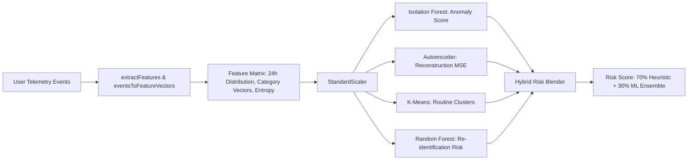
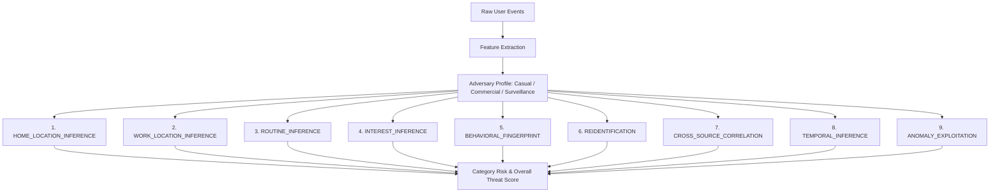
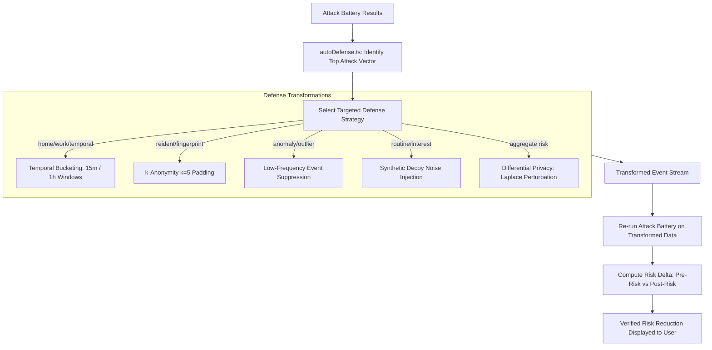

# 🛡️ PrivacyX — Next-Gen AI Privacy Defense & Real-Time Data Leak Prevention

> **PrivacyX** is an end-to-end privacy engineering platform and browser defense system. It captures web activity, intercepts real-time data leaks and PII exfiltration, trains persistent machine learning models to detect behavioral anomalies, simulates 9 real-world adversary attacks, and dynamically executes mathematical privacy-preserving defenses (Differential Privacy, $k$-Anonymity, Suppression, and Auto-Defense).

---

## 📑 Table of Contents
1. [Architecture Overview](#-architecture-overview)
2. [How the Browser Extension Works](#-how-the-browser-extension-works)
3. [How the Machine Learning Engine Works](#-how-the-machine-learning-engine-works)
4. [How the Attack Simulation Engine Works](#-how-the-attack-simulation-engine-works)
5. [How the Defense & Auto-Defense Engine Works](#-how-the-defense--auto-defense-engine-works)
6. [Quickstart & Installation](#-quickstart--installation)
7. [API Reference](#-api-reference)

---

## 🏗️ Architecture Overview

```mermaid
flowchart TD
    subgraph Browser_Environment [Client Browser]
        Tab[Web Page Navigation / Tab Switch] --> Ext[PrivacyX Shield Extension v2.0]
        Ext --> Content[content.js: Form PII Scanner]
        Ext --> BG[background.js: Service Worker]
        Ext --> Popup[popup.html: Live AI Activity Monitor]
    end

    subgraph Threat_Interception [Interception & Filtering]
        BG -->|Match| TrackerFilter[Tracker Firewall: 50+ Ad/Analytics Nets]
        BG -->|Match| BrokerFilter[Data Broker Blocker: Acxiom, Spokeo, etc.]
        BG -->|Regex| URLScanner[URL Query PII Scanner]
    end

    subgraph AI_Enrichment [AI / ML Domain Classification]
        BG -->|Fetch /api/classify| GroqRoute[Next.js /api/classify]
        GroqRoute -->|LLM Reasoning| GroqAI[Groq LLaMA 3.3 70B]
        GroqRoute -->|NLP Keywords| HeuristicNLP[Catalog & Heuristic Engine]
    end

    subgraph Core_Backend [Next.js App Router Backend]
        BG -->|Bearer Token Sync| EventAPI[/api/events: Ingestion & Time Bucketing]
        EventAPI --> MongoDB[(MongoDB: Events & Leaks)]
        MongoDB --> RiskEngine[Hybrid Risk Engine: 70% Heuristic + 30% ML]
    end

    subgraph ML_Microservice [Python FastAPI Service :8000]
        RiskEngine --> MLClient[ml-client.ts]
        MLClient --> IF[Isolation Forest: Anomaly Detection]
        MLClient --> AE[Autoencoder: Reconstruction Outliers]
        MLClient --> KM[K-Means / DBSCAN: Routine Clustering]
        MLClient --> RF[Random Forest: Re-identification Risk]
    end

    subgraph Attack_Engine [9 Adversary Attack Vectors]
        RiskEngine --> Battery[runAttackBattery]
        Battery --> Attacks[Home, Work, Routine, Interest, Fingerprint, ReID, Correlation, Temporal, Anomaly]
    end

    subgraph Defense_Engine [Mathematical Defenses]
        Attacks --> AutoDef[Auto-Defense Optimizer]
        AutoDef --> DP[Differential Privacy: Laplace Mechanism]
        AutoDef --> KAnon[k-Anonymity k=5 Padding]
        AutoDef --> Supp[Low-Frequency Event Suppression]
        AutoDef --> Noise[Synthetic Decoy Noise Injection]
        AutoDef --> ReSim[Re-Simulation & Verified Risk Reduction]
    end
```

---

## 🌐 How the Browser Extension Works

The browser extension (`extension/`) acts as the user's perimeter shield. It monitors network activity, prevents unconsented PII leaks, categorizes visited sites using AI, and securely pushes minimized telemetry to the platform.

### 1. Tab Monitoring & Immediate Event Capture
* **Event Triggers**: Listens to both `chrome.tabs.onUpdated` (when a URL is visited or finishes loading) and `chrome.tabs.onActivated` (when switching between open tabs).
* **Internal URLs Filtered**: Automatically ignores `chrome://`, `chrome-extension://`, `about:`, `edge://`, and local application domains (`localhost`, `127.0.0.1`).
* **Debouncing & Deduplication**: Employs an in-memory timestamp map (`recentDomainVisits`) with a 6-second window to prevent flooding telemetry when tabs reload assets.
* **Immediate Local Persistence**: Visited domains are immediately written to `chrome.storage.local.recentEvents` (capped at the last 30 events), ensuring real-time visibility in the extension popup even prior to server authentication.

### 2. Threat & Leak Interception
* **Tracker Firewall**: Checks requested domains against a catalog of 50+ known analytics and ad trackers (`google-analytics.com`, `doubleclick.net`, `hotjar.com`, `criteo.com`, etc.). When detected, telemetry collection is blocked, the badge counter increments, and a leak record is generated.
* **Data Broker Blocker**: Blocks requests to data broker services (`spokeo.com`, `whitepages.com`, `beenverified.com`, `acxiom.com`, etc.) and raises a critical browser alert.
* **URL PII Scanner (`scanUrlForPII`)**: Scans full query strings and hash parameters for sensitive data leaked in URLs (emails, phone numbers, credit card numbers, SSNs, API keys/tokens).
* **In-Page Form PII Scanner (`content.js`)**: Runs in the context of web pages, monitoring form inputs on blur or submission to detect credit cards, SSNs, and passwords before transmission.

### 3. AI / ML Domain Classification
* Unfamiliar domains are classified through an asynchronous call to `/api/classify?domain=${domain}`:
  1. **Groq AI LLaMA 3.3 70B**: Analyzes the domain and assigns a taxonomy category, sensitivity score ($0.05 - 0.95$), and risk label.
  2. **NLP Heuristic Fallback**: Evaluates second-level domain (SLD) keywords (e.g. `bank`, `clinic`, `pharma`, `hire`, `crypto`).
  3. **High-Risk Sensitivity Tagging**: Automatically flags healthcare ($0.95$), finance ($0.90$), career ($0.75$), and government ($0.75$) with high-risk alerts.
  4. **Domain Caching**: Results are stored in memory (`domainAiCache`) to ensure zero latency on return visits.

### 4. Batch Synchronization
* Events are queued in memory (`eventBatch`). When the batch reaches 3+ events, or when an alarm triggers (every 60s), the background worker flushes them via `POST /api/events` using the user's `Bearer` token.

---

## 🧠 How the Machine Learning Engine Works

The ML engine runs as an independent Python FastAPI microservice on port `8000` (`ml-service/`). It works alongside a hybrid risk-blending pipeline.



### 1. Feature Vectorization (`eventsToFeatureVectors`)
Incoming events are converted into numerical feature vectors:
* **Temporal**: Normalized hour of day ($[0, 23]$), day of week ($[0, 6]$), night-time flag ($22:00 - 06:00$).
* **Categorical**: One-hot encoded domain categories (technology, healthcare, finance, social, shopping, etc.).
* **Behavioral**: Duration bucket mappings, dwell times, and sensitivity coefficients.

### 2. Machine Learning Models
* **Isolation Forest (`IsolationForest(contamination=0.08)`)**:
  * Evaluates multi-dimensional isolation tree path lengths.
  * Anomalies represent rare digital behaviors (e.g., 3:00 AM visits to financial portals), generating an outlier probability score.
* **Deep Autoencoder (PyTorch / Scikit-Learn MLP)**:
  * Compresses 18-dimensional feature vectors into an 8-dimensional bottleneck latent space, then reconstructs them.
  * Anomalies produce high Mean Squared Error (MSE) reconstruction loss:
    $$\text{MSE} = \frac{1}{n}\sum_{i=1}^{n} (x_i - \hat{x}_i)^2$$
* **Routine Clustering (K-Means & DBSCAN)**:
  * Identifies behavioral personas and recurring daily cycles by clustering timestamps and dwell times.
  * Outlier points not fitting any cluster indicate unexpected schedule breaks.
* **Random Forest Re-identification Classifier (`RandomForestClassifier`)**:
  * Trained on behavioral fingerprint entropy, uniqueness indicators, and session intervals to predict the likelihood of cross-session re-identification.

### 3. Model Persistence & Continuous Training
* Fitted model artifacts are serialized to disk (`ml-service/models/*.joblib`), eliminating cold-start retraining.
* `train.py` provides offline validation using 5-fold cross-validation, reporting ROC-AUC, F1, Precision, and Recall.

---

## 🎯 How the Attack Simulation Engine Works

The attack engine (`src/lib/engine/attacks/`) simulates real-world adversary profiling techniques against user telemetry.



### 1. Requirements for Running Attacks
* **Input**: User telemetry events (minimum 3 events for baseline, 20+ for high confidence).
* **Adversary Context**: An adversary capability profile (`casual`, `commercial_broker`, `state_surveillance`) configuring noise tolerance, auxiliary dataset correlation, and observation windows.

### 2. The 9 Attack Vectors in Detail

| # | Attack Vector | Algorithm & Checks Performed |
|---|---|---|
| **1** | `HOME_LOCATION_INFERENCE` | Analyzes nocturnal activity (22:00 – 06:00). Performs spatial-temporal clustering over residential hours and calculates cluster variance. High night density yields high domicile confidence. |
| **2** | `WORK_LOCATION_INFERENCE` | Inspects weekday business-hour activity (09:00 – 17:00, Mon–Fri). Evaluates regularity and consistency across business days. |
| **3** | `ROUTINE_INFERENCE` | Constructs a Markovian state transition matrix between time-bucketed activities. Computes Shannon transition entropy; low entropy indicates predictable daily routines. |
| **4** | `INTEREST_INFERENCE` | Aggregates category frequency and recency, applying domain sensitivity weights (healthcare, finance, career). Flags sensitive personal interests exposed without protection. |
| **5** | `BEHAVIORAL_FINGERPRINT` | Computes Shannon entropy across the user's category distribution: $H(X) = -\sum P(x) \log_2 P(x)$. Evaluates uniqueness of the behavioral signature against standard population distributions. |
| **6** | `REIDENTIFICATION` | Evaluates quasi-identifier tuple uniqueness $(H, D, C, B)$ where $H$ is hour, $D$ is day, $C$ is category, and $B$ is duration. Measures $k$-anonymity deficiency in the user's footprint. |
| **7** | `CROSS_SOURCE_CORRELATION` | Correlates disjoint event sources (e.g. mobile vs browser) using temporal alignment and semantic category overlap. |
| **8** | `TEMPORAL_INFERENCE` | Reconstructs circadian rhythms, waking hours, peak activity bursts, and sleep intervals from time-bucketed event presence. |
| **9** | `ANOMALY_EXPLOITATION` | Flags rare, high-sensitivity outlier events (e.g. late-night medical searches) combined with Isolation Forest anomaly scores. Updated in-place to avoid duplicate vector reporting. |

---

## 🛡️ How the Defense & Auto-Defense Engine Works

The defense engine (`src/lib/engine/defenses/`) applies mathematical and heuristic data transformations to reduce privacy exposure while preserving utility.



### 1. Defense Strategies Explained

1. **Temporal Bucketing (`temporal_bucketing`)**:
   * Rounds raw timestamps down to 15-minute or 1-hour boundaries and clears second/millisecond offsets.
   * Blunts temporal micro-inference attacks without degrading day/hour utility.
2. **Low-Frequency Suppression (`suppression`)**:
   * Scans event distribution and removes categories or sites visited fewer than $N$ times (threshold default: 2).
   * Eliminates unique outlier visits that act as identifying behavioral fingerprints.
3. **Synthetic Decoy Noise Injection (`noise_injection`)**:
   * Synthesizes plausible browsing events across diverse categories during idle or sensitive intervals.
   * Tags generated events with `metadata.defenseNoise: true` so legitimate telemetry remains distinguishable from synthetic noise.
4. **$k$-Anonymity Padding ($k=5$) (`k_anonymity`)**:
   * Partitions events into equivalence classes based on quasi-identifiers (time bucket, day of week).
   * Injects padding events until every equivalence class contains at least $k=5$ occurrences, preventing individual re-identification.
5. **Differential Privacy Laplace Mechanism (`differential_privacy`)**:
   * Adds controlled Laplacian noise calibrated to query sensitivity $\Delta f$ and privacy budget $\varepsilon = 1.0$:
     $$M(x) = f(x) + \text{Lap}\left(\frac{\Delta f}{\varepsilon}\right)$$
   * Provides formal mathematical bounds against membership inference attacks.

### 2. The Auto-Defense Optimization Loop (`src/lib/engine/autoDefense.ts`)
* **Step 1 — Threat Evaluation**: Inspects the results of the 9 attack vectors and sorts them by risk score to identify the most critical vulnerability.
* **Step 2 — Strategy Selection**:
  * `reidentification` or `behavioral_fingerprint` $\rightarrow$ $k$-Anonymity ($k=5$).
  * `routine_inference` $\rightarrow$ Synthetic Noise Injection.
  * `home_location` or `work_location` $\rightarrow$ Temporal & Location Bucketing.
  * `anomaly_exploitation` $\rightarrow$ Outlier Suppression.
* **Step 3 — Transformation**: Executes the chosen defense pipeline on the user's event stream.
* **Step 4 — Verification via Re-simulation**: Re-runs the attack battery against the transformed telemetry to verify risk reduction before presenting results.
* **Step 5 — Non-Destructive Reset**: Clears only synthetic defense noise (`metadata.defenseNoise: true`), preserving real telemetry.

---

## 🚀 Quickstart & Installation

### Prerequisites
* **Node.js** 18+ & **npm**
* **Python** 3.10+
* **MongoDB** (Local instance or Atlas connection URI)
* **Chrome / Chromium Browser** (for the extension)

### 1. Installation
```bash
# Clone the repository
git clone https://github.com/kaavya7705/privacyx.git
cd privacyx

# Install frontend dependencies
npm install

# Install ML service dependencies
cd ml-service
pip install -r requirements.txt
cd ..
```

### 2. Environment Setup
Create a `.env.local` file in the root directory:
```env
MONGODB_URI=mongodb://localhost:27017/privacyx
JWT_SECRET=your-secure-jwt-secret-at-least-32-chars
ML_SERVICE_URL=http://localhost:8000
NEXT_PUBLIC_ML_SERVICE_URL=http://localhost:8000
GROQ_API_KEY=your_groq_api_key_here  # Optional for Groq LLaMA 3.3 AI
```

### 3. Launch Services

**Terminal 1 — Machine Learning Microservice:**
```bash
npm run ml:start
# Runs FastAPI on http://localhost:8000
```

**Terminal 2 — Next.js Application:**
```bash
npm run dev
# Runs PrivacyX Web App on http://localhost:3000
```

### 4. Load the Browser Extension
1. Open Chrome and navigate to `chrome://extensions/`.
2. Turn on **Developer mode** in the upper right.
3. Click **Load unpacked** and select the `extension/` folder in this repository.
4. Click the PrivacyX extension icon in the toolbar, click **Quick Auto-Connect**, and start browsing.

---

## 📡 API Reference

| Method | Endpoint | Description |
|---|---|---|
| `GET` | `/api/health` | Health status of MongoDB and the Python ML service |
| `POST` | `/api/events` | Ingests telemetry events, parses timestamps, and applies bucketing |
| `DELETE` | `/api/events` | Resets the user's telemetry stream |
| `GET/POST`| `/api/leaks` | Records and retrieves intercepted PII and tracker leak events |
| `POST` | `/api/attack` | Executes the 9 adversary attack battery + ML anomaly scoring |
| `GET/POST`| `/api/defense` | Applies mathematical privacy defenses to telemetry |
| `DELETE` | `/api/defense` | Clears synthetic noise events and restores baseline risk |
| `POST` | `/api/auto-defense` | Selects optimal defense for top attack and verifies risk reduction |
| `GET` | `/api/classify` | AI-powered domain categorization and sensitivity assessment |
| `GET` | `http://localhost:8000/models` | Lists persisted Scikit-Learn `.joblib` models and evaluation metrics |
| `POST` | `http://localhost:8000/predict` | Real-time ML inference for anomaly detection and re-identification |
| `POST` | `http://localhost:8000/train` | Triggers retraining of persisted machine learning models |

---

## 📄 License
MIT License. Built for privacy engineering, cybersecurity research, and personal privacy preservation.
