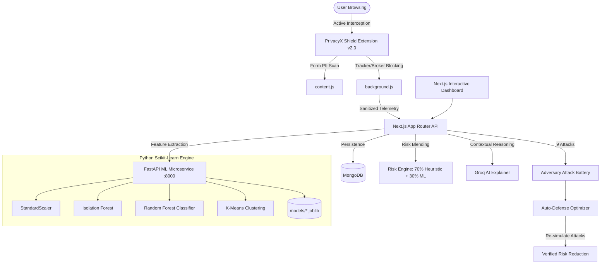

# 🛡️ PrivacyX — Next-Gen AI Privacy Defense & Real-Time Data Leak Prevention

> **PrivacyX** is an end-to-end privacy engineering platform and browser defense system. It simulates adversary surveillance attacks, intercepts real-time data leaks and PII exfiltration, trains persistent machine learning models to detect behavioral anomalies, and dynamically executes mathematical privacy-preserving defenses (Differential Privacy, K-Anonymity, Suppression, and Auto-Defense).

---

## 🌟 Why PrivacyX Matters (Impact & Vision)

Modern web browsing silently leaks high-dimensional metadata (timestamps, domain categories, dwell times, IP routing). Attackers and data brokers aggregate these digital footprints to infer:
- **Exact home & work locations** (temporal-spatial clustering)
- **Daily routines & sleep patterns**
- **Personal interests, political/medical leanings**
- **Unique behavioral fingerprints** enabling cross-platform re-identification

**PrivacyX transforms passive browsing into an actively defended fortress:**
1. **Real-Time Data Leak Prevention**: Intercepts sensitive PII (emails, phone numbers, credit cards, SSNs, API tokens) and blocks connections to known tracking networks and data brokers before exfiltration occurs.
2. **True Machine Learning Engine**: Microservice powered by Scikit-Learn with persisted model artifacts (`.joblib`), continuous retraining, Isolation Forest anomaly detection, and Random Forest risk scoring.
3. **Real Attack Simulations**: 9 evidence-backed adversary attack algorithms demonstrating exact vulnerabilities.
4. **Dynamic Auto-Defense**: Evaluates threats and applies Pareto-optimal defenses (Differential Privacy $\varepsilon=1.0$, $k$-Anonymity $k=5$, Bucketing, Noise Injection) with verified risk reduction.

---

## 🏗️ System Architecture



---

## 🚀 Key Modules & Capabilities

### 1. Real-Time Data Leak Prevention (`extension/`)
- **Manifest V3 Architecture**: High-efficiency background service worker with `declarativeNetRequest` and `webRequest` interception.
- **In-Page Form PII Scanner (`content.js`)**: Scans input fields and forms in real time to alert users before submitting credit cards, SSNs, API keys, or emails to unauthorized third parties.
- **Tracker & Data Broker Firewall**: Built-in blocklists for major telemetry endpoints (Google Analytics, Hotjar, Criteo, BlueKai, Acxiom, Spokeo, etc.).
- **Shield Modes**: Toggle between **Active Shield** (auto-block trackers and broker requests) and **Monitor Mode** (passive audit).

### 2. Persistent Machine Learning Service (`ml-service/`)
- **Microservice**: Built with FastAPI and Uvicorn on port `8000`.
- **Model Persistence**: Models are fitted, evaluated, and saved to disk via `joblib` inside `ml-service/models/` — eliminating throwaway one-shot fits.
- **Isolation Forest**: Contamination-tuned anomaly detection identifying unusual browsing velocity, off-hours activity, and anomalous domain distributions.
- **Random Forest Classifier**: Trained on behavioral feature matrices to assess cross-session re-identification probability.
- **Clustering (K-Means & DBSCAN)**: Uncovers behavioral personas and temporal routines.
- **Offline Batch Trainer (`train.py`)**: Generates calibrated synthetic behavioral vectors and validates models using ROC-AUC, CV F1, Precision, and Recall.

### 3. Attack Simulation Battery (`src/lib/engine/attacks/`)
9 attack algorithms test collected telemetry against different adversary profiles:
1. `HOME_LOCATION_INFERENCE`: Detects domicile via overnight cluster analysis.
2. `WORK_LOCATION_INFERENCE`: Identifies workplace via business-hour routines.
3. `ROUTINE_INFERENCE`: Reconstructs recurring daily habits.
4. `INTEREST_INFERENCE`: Infers sensitive interest categories.
5. `BEHAVIORAL_FINGERPRINT`: Calculates uniqueness entropy across category distributions.
6. `REIDENTIFICATION`: Quantifies uniqueness in population datasets.
7. `CROSS_SOURCE_CORRELATION`: Links disjoint browsing sessions.
8. `TEMPORAL_INFERENCE`: Pinpoints active hours and sleep cycles.
9. `ANOMALY_EXPLOITATION`: Pinpoints rare, identifying digital outliers.

### 4. Mathematical Defense & Auto-Defense (`src/lib/engine/defenses/`)
- **Timestamp Bucketing**: Collapses exact timestamps into 1-hour intervals.
- **Location Generalization**: Truncates coordinates to broad regional bounds.
- **Low-Frequency Suppression**: Drops rare category visits that act as fingerprints.
- **Noise Injection**: Injects synthetic browsing noise into temporal intervals.
- **$k$-Anonymity ($k=5$)**: Guarantees at least $k$ events in every temporal bucket.
- **Differential Privacy ($\varepsilon=1.0$)**: Adds Laplacian noise calibrated to query sensitivity:
  $$f(x) + \text{Lap}\left(\frac{\Delta f}{\varepsilon}\right)$$
- **Auto-Defense Engine (`autoDefense.ts`)**: Evaluates attack results, selects the optimal defense configuration using Pareto risk-utility tradeoffs, and verifies efficacy by re-running the attack battery.

---

## 🛠️ Quickstart & Development

### Prerequisites
- **Node.js** 18+ & **npm**
- **Python** 3.10+
- **MongoDB** (Local or MongoDB Atlas connection string)

### 1. Clone & Install Dependencies
```bash
# Install Node.js frontend dependencies
npm install

# Install Python ML service dependencies
cd ml-service
pip install -r requirements.txt
cd ..
```

### 2. Configure Environment Variables
Create a `.env.local` file in the root directory:
```env
MONGODB_URI=mongodb://localhost:27017/privacyx
JWT_SECRET=your-secure-jwt-secret-at-least-32-chars
ML_SERVICE_URL=http://localhost:8000
NEXT_PUBLIC_ML_SERVICE_URL=http://localhost:8000
GROQ_API_KEY=your_groq_api_key_here  # Optional for AI Explainer
```

### 3. Train Initial Machine Learning Models
```bash
npm run ml:train
# or: python ml-service/train.py
```

### 4. Start Services Locally

**Terminal 1 — Machine Learning Microservice:**
```bash
npm run ml:start
# Runs FastAPI on http://localhost:8000
```

**Terminal 2 — Next.js Application:**
```bash
npm run dev
# Runs Web App on http://localhost:3000
```

### 5. Install the Browser Extension
1. Open Google Chrome or any Chromium browser and navigate to `chrome://extensions/`.
2. Enable **Developer mode** (toggle in the top-right corner).
3. Click **Load unpacked** and select the `extension/` folder in this repository.
4. Click the PrivacyX Shield icon in your browser toolbar to view live protection stats!

---

## 🐳 Docker Deployment

Run the complete full-stack environment with a single command:
```bash
docker-compose up --build
```
This spins up:
- **MongoDB** on `localhost:27017`
- **FastAPI ML Service** on `localhost:8000`
- **Next.js Web Application** on `localhost:3000`

---

## 📡 API Endpoints

| Method | Endpoint | Description |
|---|---|---|
| `GET` | `/api/health` | System health check (MongoDB, ML service) |
| `POST` | `/api/attack` | Executes 9 adversary attacks + ML inference |
| `GET/POST`| `/api/defense` | Simulates and applies defense transformations |
| `GET/POST`| `/api/auto-defense` | Evaluates threat vectors & applies auto-defense |
| `GET/POST`| `/api/leaks` | Records & retrieves detected PII and tracker leaks |
| `GET` | `http://localhost:8000/models` | Lists persisted ML models and metrics |
| `POST`| `http://localhost:8000/predict` | Real-time ML inference against saved models |
| `POST`| `http://localhost:8000/train` | Triggers retraining of persistent models |

---

## 📄 License
MIT License. Built for security, transparency, and personal privacy preservation.
